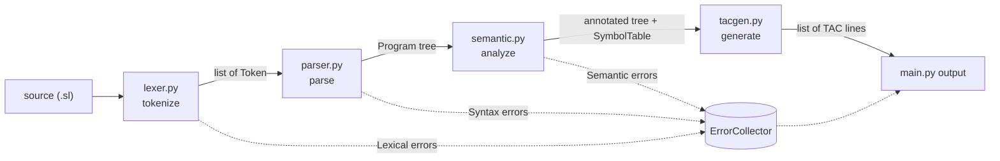
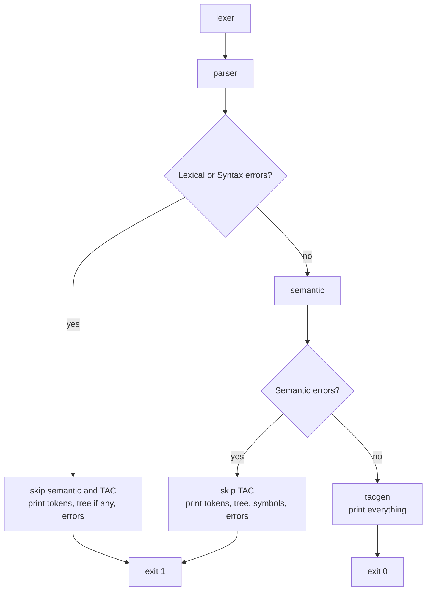

# FLOW: SmartLang Compiler

Tags: `[PLANNED]` until built, then `[BUILT]`.

## 1. Pipeline diagram [PLANNED]

## 2. Data passed between stages [PLANNED]

| Stage | Input | Output | Notes |
|---|---|---|---|
| lexer | source text, `ErrorCollector` | `list[Token]` | Always ends with `EOF`. Bad input becomes `INVALID` tokens plus a Lexical error. |
| parser | `list[Token]`, `ErrorCollector` | `Program` tree | Never raises or hangs. Skips `INVALID` tokens silently. Returns best partial tree after syntax errors. |
| semantic | `Program`, `ErrorCollector` | `SymbolTable`, plus annotations on the tree | Annotations: `expr_type`, `tac_name`, `scope_id`. Pass 1 collects function signatures, pass 2 checks bodies. |
| tacgen | annotated `Program` | `list[str]` | Precondition: zero errors. Temporaries `t1..`, labels `L1..`, numbered per program. |
| main | path, flags | exit code | Prints sections in order: tokens, tree, symbol tables, errors, TAC. |

## 3. Error flow [PLANNED]

- All errors go through one `ErrorCollector`, in the format `[Kind Error] Line L, Col C: message`.
- The error section is ordered Lexical, then Syntax, then Semantic, each sorted by line, col.
- Syntax errors use panic-mode recovery (D-003); lexical errors continue after an `INVALID` token.
- Exit codes: 0 no errors, 1 any compile error, 2 usage or file error.

## 4. Module table

Status per module: `tokens.py` and `errors.py` are [BUILT] (Phase 0); all others are [PLANNED].

| Module | Status | Public interface | Depends on |
|---|---|---|---|
| `tokens.py` | [BUILT] | `TokenType`, `Token(type, lexeme, line, col)` | none |
| `errors.py` | [BUILT] | `CompilerError`, `ErrorCollector` (`report`, `has_errors`, `has_kind`, `all`) | none |
| `lexer.py` | [PLANNED] | `tokenize(source, errors) -> list[Token]` | `tokens`, `errors` |
| `ast_nodes.py` | [PLANNED] | node dataclasses with `label()` and `children()` | none |
| `parser.py` | [PLANNED] | `parse(tokens, errors) -> Program` | `tokens`, `errors`, `ast_nodes` |
| `tree_export.py` | [PLANNED] | `tree_to_text`, `tree_to_dot`, `export_png` | `ast_nodes` only |
| `symbol_table.py` | [PLANNED] | `Symbol`, `SymbolTable` (`enter_scope`, `exit_scope`, `declare`, `lookup`, `lookup_current`, `current_level`, `dump`) | none |
| `semantic.py` | [PLANNED] | `analyze(tree, errors) -> SymbolTable` | `parser` outputs, `ast_nodes`, `symbol_table`, `errors` |
| `tacgen.py` | [PLANNED] | `generate(tree) -> list[str]` | `semantic` annotations, `ast_nodes` |
| `main.py` | [PLANNED] | `run(path, flags) -> int` | all of the above |

Dependency direction (no cycles):
`tokens, errors` ← `lexer` ← `parser` (also `ast_nodes`) ← `semantic` (uses `symbol_table`) ← `tacgen` ← `main`.
