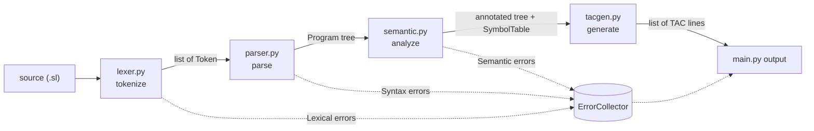
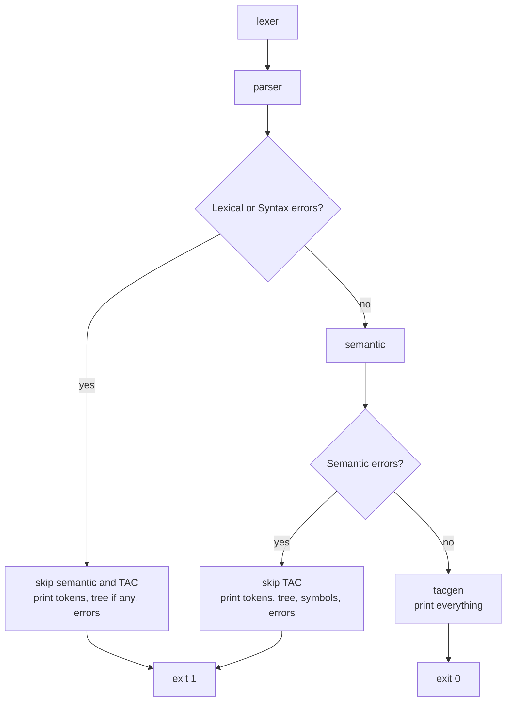

# FLOW: SmartLang Compiler

Tags: `[PLANNED]` until built, then `[BUILT]`.

## 1. Pipeline diagram [PLANNED; source → lexer → parser → tree output in main is BUILT]

## 2. Data passed between stages [PLANNED; lexer and parser rows and the tokens/tree parts of main are BUILT]

| Stage | Input | Output | Notes |
|---|---|---|---|
| lexer | source text, `ErrorCollector` | `list[Token]` | Always ends with `EOF`. Bad input becomes `INVALID` tokens plus a Lexical error. |
| parser [BUILT, valid programs; recovery is Phase 3] | `list[Token]`, `ErrorCollector` | `Program` tree | Never raises or hangs. Skips `INVALID` tokens silently. Returns best partial tree after syntax errors. |
| semantic | `Program`, `ErrorCollector` | `SymbolTable`, plus annotations on the tree | Annotations: `expr_type`, `tac_name`, `scope_id`. Pass 1 collects function signatures, pass 2 checks bodies. |
| tacgen | annotated `Program` | `list[str]` | Precondition: zero errors. Temporaries `t1..`, labels `L1..`, numbered per program. |
| main | path, flags | exit code | Prints sections in order: tokens, tree, symbol tables, errors, TAC. |

## 3. Error flow [PLANNED]

- All errors go through one `ErrorCollector`, in the format `[Kind Error] Line L, Col C: message`.
- The error section is ordered Lexical, then Syntax, then Semantic, each sorted by line, col.
- Syntax errors use panic-mode recovery (D-003); lexical errors continue after an `INVALID` token.
- Exit codes: 0 no errors, 1 any compile error, 2 usage or file error.

## 4. Module table

Status per module: `tokens.py` and `errors.py` are [BUILT] (Phase 0); `lexer.py` is [BUILT] (Phase 1);
`ast_nodes.py`, `parser.py`, `tree_export.py` are [BUILT] (Phase 2, valid programs only);
`main.py` is partly built (`--tokens` Phase 1, `--tree` and `--tree-png` Phase 2); all others are [PLANNED].

Parser internals [BUILT]: `parse` creates a `Parser` (INVALID tokens filtered out) and calls `parse_program`, which loops
`parse_top_level` until EOF. Each grammar rule of SPEC section 6 has a method of the same name (`parse_if_stmt`, `parse_for_stmt`,
`parse_add_expr`, ...). The six binary levels (`parse_or_expr` to `parse_term`) share `parse_binary_level`, a loop that wraps the
tree so far as the left child (left associativity); calling them in layers gives precedence. A level with one operand returns it
unchanged (D-004), so only `BinaryOp`, `UnaryOp`, `Literal`, `Identifier` and `Call` nodes exist. `else if` is an `If` stored in
`else_branch`. Phase 2 has no recovery: the first `ParseError` is reported once and the finished top-level items are returned (D-018). INVALID tokens are filtered out in `Parser.__init__`; an error whose
offending token directly follows a skipped INVALID token is not reported (D-020).

Tree export [BUILT]: `tree_to_text` and `tree_to_dot` walk the tree with `label()` and `children()`; `export_png` pipes the DOT through the `graphviz` package and writes the PNG bytes (no stray `.gv` file), raises `RuntimeError` with an install hint if `dot` is missing.

Lexer internals [BUILT]: `tokenize` creates a `Lexer`; `scan_next` picks a scanner by the first character:
whitespace/comments skipped, `scan_word` (identifier or keyword), `scan_number` (int, float or one INVALID run),
`scan_char` (char literal or INVALID), `scan_operator_or_delimiter` (two-character operators first, then single
characters, anything else INVALID). Every INVALID token also reports a Lexical error. The result always ends with EOF.

| Module | Status | Public interface | Depends on |
|---|---|---|---|
| `tokens.py` | [BUILT] | `TokenType`, `Token(type, lexeme, line, col)` | none |
| `errors.py` | [BUILT] | `CompilerError`, `ErrorCollector` (`report`, `has_errors`, `has_kind`, `all`) | none |
| `lexer.py` | [BUILT] | `tokenize(source, errors) -> list[Token]` | `tokens`, `errors` |
| `ast_nodes.py` | [BUILT] | node dataclasses with `label()` and `children()` | none |
| `parser.py` | [BUILT: valid programs only] | `parse(tokens, errors) -> Program` | `tokens`, `errors`, `ast_nodes` |
| `tree_export.py` | [BUILT] | `tree_to_text`, `tree_to_dot`, `export_png` | `ast_nodes` only |
| `symbol_table.py` | [PLANNED] | `Symbol`, `SymbolTable` (`enter_scope`, `exit_scope`, `declare`, `lookup`, `lookup_current`, `current_level`, `dump`) | none |
| `semantic.py` | [PLANNED] | `analyze(tree, errors) -> SymbolTable` | `parser` outputs, `ast_nodes`, `symbol_table`, `errors` |
| `tacgen.py` | [PLANNED] | `generate(tree) -> list[str]` | `semantic` annotations, `ast_nodes` |
| `main.py` | [BUILT: `--tokens`, `--tree`, `--tree-png`] | `run(path, flags, png_path=None) -> int` (D-019) | `lexer`, `parser`, `tree_export`, `errors`, `tokens` now; all of the above later |

Dependency direction (no cycles):
`tokens, errors` ← `lexer` ← `parser` (also `ast_nodes`) ← `semantic` (uses `symbol_table`) ← `tacgen` ← `main`.
