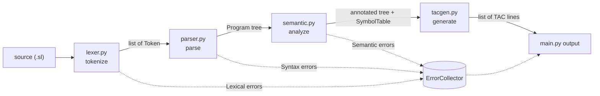
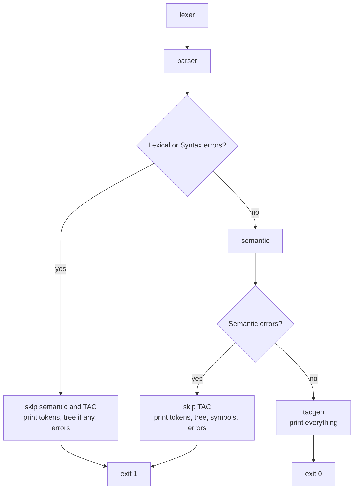
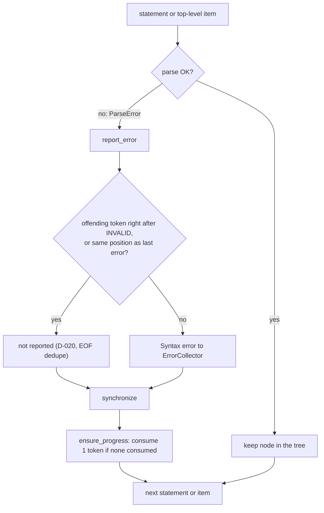

# FLOW: SmartLang Compiler

Tags: `[PLANNED]` until built, then `[BUILT]`.

## 1. Pipeline diagram [PLANNED; source → lexer → parser (with error recovery) → semantic (5a and 5b) is BUILT; tacgen is PLANNED]

## 2. Data passed between stages [PLANNED; lexer, parser, semantic (5a, 5b) rows and the tokens/tree/symbols parts of main are BUILT]

| Stage | Input | Output | Notes |
|---|---|---|---|
| lexer | source text, `ErrorCollector` | `list[Token]` | Always ends with `EOF`. Bad input becomes `INVALID` tokens plus a Lexical error. |
| parser [BUILT, with panic-mode recovery, D-021, D-022] | `list[Token]`, `ErrorCollector` | `Program` tree | Never raises or hangs. Skips `INVALID` tokens silently. Reports every syntax error it finds; the partial tree keeps all items and statements that parsed plus the recovered function. |
| semantic [BUILT 5a: scopes, declarations, expression typing; BUILT 5b: callee, arity, argument types, return type, missing return] | `Program`, `ErrorCollector` | `SymbolTable`, plus annotations on the tree | Annotations: `expr_type`, `tac_name`, `scope_id`. Pass 1 collects function signatures, pass 2 checks bodies. |
| tacgen | annotated `Program` | `list[str]` | Precondition: zero errors. Temporaries `t1..`, labels `L1..`, numbered per program. |
| main | path, flags | exit code | Prints sections in order: tokens, tree, symbol tables, errors, TAC. |

## 3. Error flow [PLANNED; the syntax-error recovery inside the parser is BUILT, see 3a]

- All errors go through one `ErrorCollector`, in the format `[Kind Error] Line L, Col C: message`.
- The error section is ordered Lexical, then Syntax, then Semantic, each sorted by line, col.
- Syntax errors use panic-mode recovery (D-003, D-022) [BUILT]; lexical errors continue after an `INVALID` token.
- Exit codes: 0 no errors, 1 any compile error, 2 usage or file error.

## 3a. Parser error recovery [BUILT]

- Recovery points: each statement in `parse_block`, each item in `parse_program`, the header in `parse_func_rest`.
- Statement sync: consume `;`, stop before `}`, `{`, `if while for return const` and type keywords. Top-level sync:
  consume `;` or a run of `}`, stop before `const` or a type. Both end at EOF.
- A missing `;` that is clearly forgotten (next token on a later line, a statement keyword, `}` or EOF) is reported and NOT skipped (D-024).
- A failed statement is dropped; a broken function stays as a `FunctionDecl` (D-021). A stray `else` is reported and its block kept.

## 4. Module table

Status per module: `tokens.py` and `errors.py` are [BUILT] (Phase 0); `lexer.py` is [BUILT] (Phase 1);
`ast_nodes.py`, `parser.py`, `tree_export.py` are [BUILT] (Phases 2 and 3); `symbol_table.py` is [BUILT] (Phase 4);
`semantic.py` is [BUILT] for Phases 5a and 5b; `main.py` is partly built (`--tokens` Phase 1, `--tree` and `--tree-png` Phase 2, `--symbols` Phase 5a); all others are [PLANNED].

Symbol table internals [BUILT]: `SymbolTable` maintains two lists of `_Scope` records: `_active` (the currently open
lexical scopes from outermost `global` to innermost) and `_all_scopes` (append-only creation-order history of every scope
ever entered). `enter_scope(label)` pushes a new `_Scope` onto both lists and returns its sequential `scope_id`;
`exit_scope()` pops from `_active` only so exited scopes remain available for `dump()`. `declare(symbol)` returns `False`
(keeping the original `Symbol`) on same-scope redeclaration, and otherwise sets `symbol.scope_level` to the current
scope's level and stores `symbol` in `_active[-1]`; `lookup(name)` walks `reversed(_active)` outward;
`lookup_current(name)` checks only `_active[-1]`; `dump()` formats every scope in `_all_scopes` (D-027).

Parser internals [BUILT]: `parse` creates a `Parser` (INVALID tokens filtered out) and calls `parse_program`, which loops
`parse_top_level` until EOF. Each grammar rule of SPEC section 6 has a method of the same name (`parse_if_stmt`, `parse_for_stmt`,
`parse_add_expr`, ...). The six binary levels (`parse_or_expr` to `parse_term`) share `parse_binary_level`, a loop that wraps the
tree so far as the left child (left associativity); calling them in layers gives precedence. A level with one operand returns it
unchanged (D-004), so only `BinaryOp`, `UnaryOp`, `Literal`, `Identifier` and `Call` nodes exist. `else if` is an `If` stored in
`else_branch`. Phase 2 has no recovery: the first `ParseError` is reported once and the finished top-level items are returned (D-018). INVALID tokens are filtered out in `Parser.__init__`; an error whose
offending token directly follows a skipped INVALID token is not reported (D-020).

Tree export [BUILT]: `tree_to_text` and `tree_to_dot` walk the tree with `label()` and `children()`; `export_png` pipes the DOT through the `graphviz` package and writes the PNG bytes (no stray `.gv` file), raises `RuntimeError` with an install hint if `dot` is missing.

Lexer internals [BUILT]: `tokenize` creates a `Lexer`; `scan_next` picks a scanner by the first character:
whitespace/comments skipped, `scan_word` (identifier or keyword), `scan_number` (int, float or one INVALID run),
`scan_char` (char literal or INVALID), `scan_operator_or_delimiter` (two-character operators first, then single
characters, anything else INVALID). Every INVALID token also reports a Lexical error. The result always ends with EOF.

| Module | Status | Public interface | Depends on |
|---|---|---|---|
| `tokens.py` | [BUILT] | `TokenType`, `Token(type, lexeme, line, col)` | none |
| `errors.py` | [BUILT] | `CompilerError`, `ErrorCollector` (`report`, `has_errors`, `has_kind`, `all`) | none |
| `lexer.py` | [BUILT] | `tokenize(source, errors) -> list[Token]` | `tokens`, `errors` |
| `ast_nodes.py` | [BUILT] | node dataclasses with `label()` and `children()` | none |
| `parser.py` | [BUILT: panic-mode recovery, partial tree] | `parse(tokens, errors) -> Program` | `tokens`, `errors`, `ast_nodes` |
| `tree_export.py` | [BUILT] | `tree_to_text`, `tree_to_dot`, `export_png` | `ast_nodes` only |
| `symbol_table.py` | [BUILT] | `Symbol`, `SymbolTable` (`enter_scope`, `exit_scope`, `declare`, `lookup`, `lookup_current`, `current_level`, `dump`) | none |
| `semantic.py` | [BUILT: Phases 5a and 5b] | `analyze(tree, errors) -> SymbolTable` | `parser` outputs, `ast_nodes`, `symbol_table`, `errors` |
| `tacgen.py` | [PLANNED] | `generate(tree) -> list[str]` | `semantic` annotations, `ast_nodes` |
| `main.py` | [BUILT: `--tokens`, `--tree`, `--tree-png`, `--symbols`] | `run(path, flags, png_path=None) -> int` (D-019) | `lexer`, `parser`, `tree_export`, `errors`, `tokens` now; all of the above later |

Dependency direction (no cycles):
`tokens, errors` ← `lexer` ← `parser` (also `ast_nodes`) ← `semantic` (uses `symbol_table`) ← `tacgen` ← `main`.

## 5. Semantic analyzer internals (Phases 5a and 5b) [BUILT]

`analyze` builds an `Analyzer` and runs `analyze_program`: it opens `Scope 0 (global)`, pass 1 (`collect_functions`) declares every
function signature (a duplicate name is an error), then pass 2 walks the items in source order, so a global variable is visible
only after its declaration (D-028). `check_function` opens one scope (`function NAME`) for the parameters and the body's top level
(`FunctionDecl.scope_id == body.scope_id`); `check_block` opens a `block` scope; `check_for` opens a `for` scope that holds the init variable.
`type_expr` types an expression and stores `expr_type`; operators go through `binary_result` (the SPEC table) and one `error` type
stops cascades (D-031). `declare_variable` assigns a unique `tac_name` (D-029). `type_call` (5b, D-036) types every argument, then checks the callee (undeclared, or a variable: error type),
the arity, and each argument against its parameter; the call keeps the function's return type. `check_function` keeps
`current_function` (saved and restored) so `check_return` compares each `return` with its own function's type, and
`check_missing_return` reports at the closing brace (`Block.end_line/end_col`, D-034); the rule is strict (D-035).

`main.py` wraps all stages in `run_stages`; a `RecursionError` (3000-term chain with `--tree` or `--tree-png`) gives one stderr line and exit 1 (D-037).

`main.py` stage order [BUILT]: tokens, parse tree, symbol tables (`--symbols`), errors. The semantic stage runs when the parser ran and
there are no Lexical or Syntax errors (D-031); semantic errors do not stop `--symbols` from printing the tables.

